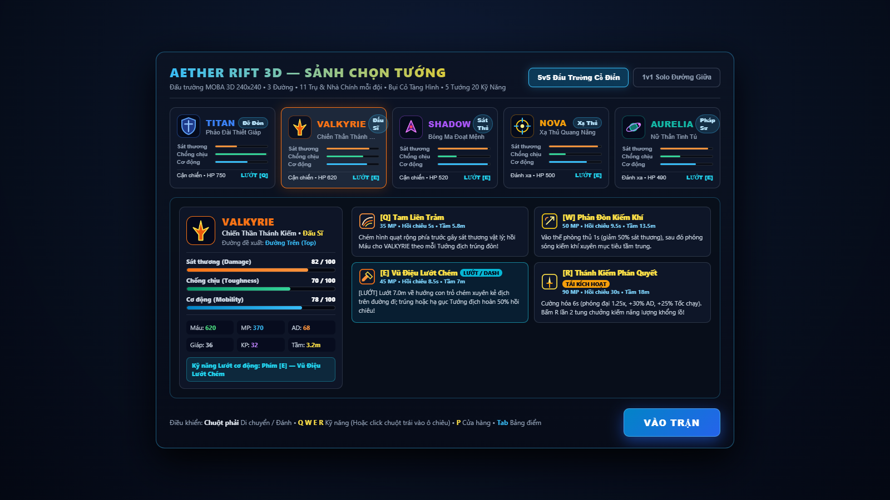
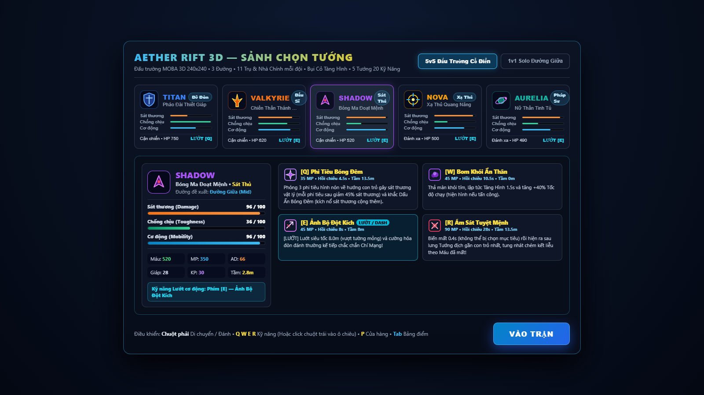
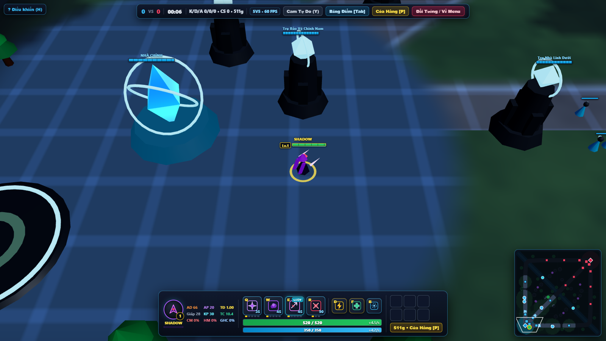
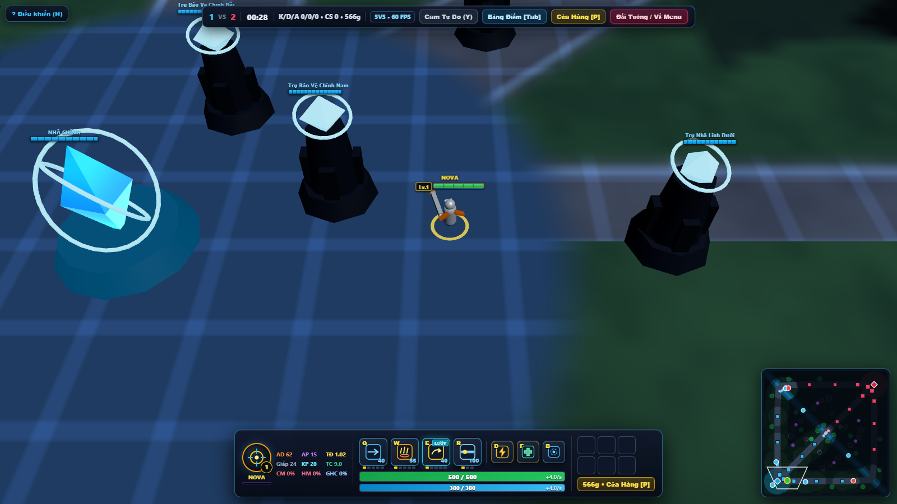
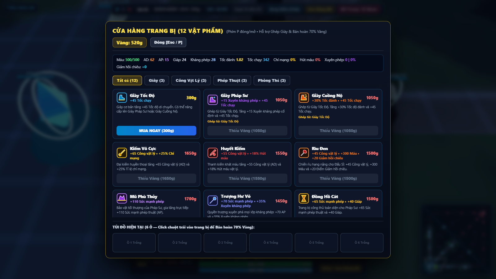

<div align="center">

# ⚔️ AETHER RIFT 3D — MOBAGAME

**MOBA 3D chạy trên trình duyệt · Xây bằng Three.js + bitecs + TypeScript**

Một đấu trường MOBA 3D hoàn chỉnh, chạy 100% phía client — không cần server, không cần tài khoản. Chọn tướng, vào đường, farm lính, mua đồ, phá trụ và kết thúc nhà chính đối phương.



</div>

---

## ✨ Tính năng nổi bật

- **Bản đồ 240×240** với 3 đường, 22 trụ + 2 nhà chính, 6 bãi rừng, 18 bụi cỏ tàng hình và 2 bệ tăng tốc.
- **2 chế độ chơi:** `5v5 Đấu Trường Cổ Điển` (đội hình 2 Top / 1 Mid / 2 Bot) và `1v1 Solo Đường Giữa`.
- **5 tướng · 20 kỹ năng** với cơ chế riêng: đòn bay xuyên mục tiêu, lướt tường mỏng, tàng hình, kết liễu theo máu đã mất, rào năng lượng giam giữ, thiên thạch nhiều nhịp, chưởng ánh sáng toàn bản đồ...
- **Hệ thống chiến đấu sâu:** giáp vật lý / kháng phép, xuyên giáp, chí mạng, hút máu, giảm hồi chiêu, khiêu khích trụ, hiệu ứng trạng thái (choáng / trói / làm chậm / không thể chọn mục tiêu).
- **Cửa hàng 12 trang bị** với cơ chế ghép đồ (mua component → nâng cấp), hoàn tiền 70% khi bán, và build đồ tự động cho bot theo vai trò.
- **AI 9 bot** biết farm,trade skill, né trụ, rút lui khi máu thấp, mua đồ và nâng chiêu theo cấp độ.
- **Sương mù chiến tranh**, minimap thời gian thực, bảng điểm, thanh máu nổi, số sát thương bay, rung màn hình và hiệu ứng kỹ năng bằng particle.
- **Hiệu suất:** mô phỏng ECS cố định 30Hz (bitecs), render interpolation mượt, shadow map PCFSoft, tone mapping ACES.

---

## 🎮 Ảnh chụp thực tế

### Sảnh chọn tướng — 5 tướng, chỉ số và bộ kỹ năng


### Trận đấu 5v5 — HUD, minimap và bản đồ 3D


### Đường giữa — lính, trụ và tướng đối đầu


### Cửa hàng trang bị — 12 item, ghép đồ và bán đồ


---

## 🧙 Danh sách tướng

| Tướng | Vai trò | Đường | Đặc trưng |
|---|---|---|---|
| **TITAN** | Đỡ Đòn | Top | Lướt húc + khiên, pháo đài giảm 40% sát thương, địa chấn choáng, rào năng lượng giam địch 2.5s |
| **VALKYRIE** | Đấu Sĩ | Top | Chém quạt hồi máu, thế phòng thủ phóng sóng kiếm, lướt hoàn 50% hồi chiêu, kỹ năng cuối 2 lần bấm |
| **SHADOW** | Sát Thủ | Mid | 3 phi tiêu để Dấu Ấn, khói tàng hình, lướt chí mạng + vượt tường, ám sát biến mất rồi kết liễu |
| **NOVA** | Xạ Thủ | Bot | Đạn xuyên giáp, mưa tên lửa, lướt tăng tốc đánh, **đại bác toàn bản đồ** |
| **AURELIA** | Pháp Sư | Mid | Cầu tinh tú nổ diện rộng, vòng trói không gian, dịch chuyển + 3 cầu lửa truy đuổi, bão 4 thiên thạch |

> ⚖️ Bản `1.0.0` đã được **cân bằng lại** — xem chi tiết ở mục [Balance Patch](#-balance-patch-10).

---

## ⌨️ Điều khiển

| Phím | Chức năng |
|---|---|
| **Chuột phải** | Di chuyển / tấn công mục tiêu |
| **Q / W / E / R** | Tung kỹ năng (hoặc click vào ô chiêu trên HUD) |
| **D / F** | Tốc Biến / Hồi Máu |
| **B** | Biến về nhà |
| **P** | Mở cửa hàng trang bị |
| **Tab** | Bảng điểm |
| **A + Chuột trái** | Attack-Move (vừa đi vừa đánh) |
| **S** | Dừng lại |
| **Space / Y** | Khóa camera |
| **1 / 2 / 3 / 4** | Nâng cấp Q / W / E / R |

---

## 🚀 Cài đặt & chạy

**Yêu cầu:** Node.js 18+

```bash
git clone https://github.com/TunAnh0711/MOBAGAME.git
cd MOBAGAME
npm install
npm run dev
```

Mở trình duyệt tại `http://localhost:5173`.

### Build production

```bash
npm run build     # typecheck + đóng gói vào dist/
npm run preview   # xem bản production
npm run typecheck # chỉ kiểm tra TypeScript
```

---

## 🛠️ Công nghệ

| Layer | Stack |
|---|---|
| Render 3D | [Three.js](https://threejs.org/) 0.187 (ACES tone mapping, PCFSoft shadow) |
| ECS | [bitecs](https://github.com/NateTheGreatt/bitecs) 0.4 — mô phỏng cố định 30Hz |
| Collision / pathfinding | Grid A* 80×80 + mesh BVH |
| UI | TypeScript + DOM thuần (không framework) |
| Build | [Vite](https://vite.dev/) 6 + TypeScript 5.8 |

---

## ⚖️ BALANCE PATCH 1.0

Bản phát hành này đi kèm đợt **cân bằng lại** toàn diện dựa trên phân tích sát thương thực tế:

### 🔧 Sửa lỗi cơ chế (quan trọng nhất)

| Vấn đề | Trước | Sau |
|---|---|---|
| **SHADOW Q** — 3 phi tiêu mỗi viên gây **toàn bộ** sát thương → 3× DPS | 3 × 100% | 100% + 55% + 55% |
| **AURELIA E** — 3 cầu lửa truy đuổi, mỗi cầu full damage | 3 × 100% | 100% + 50% + 50% |

Đã thêm trường `projectileDamageFalloff` vào `SkillDef` và áp dụng `damage × falloff^n` cho cả hai kỹ năng. Đây là thay đổi có ảnh hưởng lớn nhất tới meta — hai tướng này từng áp đảo nhờ burst không tương xứng với mana và hồi chiêu.

### 📉 Giảm sức mạnh

| Tướng | Chỉ số | Trước → Sau |
|---|---|---|
| SHADOW | Q base / rank / AD ratio | 72 / 25 / 0.70 → **66 / 22 / 0.62** |
| SHADOW | R base / rank / AD / execute / CD | 225 / 80 / 1.15 / 0.60 / 26s → **205 / 75 / 1.00 / 0.55 / 28s** |
| NOVA | R (toàn bản đồ) base / rank / AD / AP / CD | 300 / 100 / 1.15 / 0.70 / 34s → **235 / 80 / 0.80 / 0.50 / 40s** |
| NOVA | R delay (telegraph) | 0.55s → **0.65s** |
| AURELIA | E base / rank / AP | 55 / 20 / 0.35 → **44 / 16 / 0.28** |

### 📈 Tăng sức sống (bù cho đợt nerf)

| Tướng | Chỉ số | Trước → Sau |
|---|---|---|
| SHADOW | HP / HP mỗi cấp | 500 / 76 → **520 / 80** |
| NOVA | HP / HP mỗi cấp | 480 / 72 → **500 / 76** |

**Mục tiêu:** kéo SHADOW và NOVA về cùng trục sống còn với các tướng còn lại, trong khi vẫn giữ nguyên bản sắc "sát thủ bùng nổ" và "xạ thủ tầm xa". Mô tả kỹ năng trong game đã được cập nhật theo số liệu mới.

---

## 📁 Cấu trúc dự án

```
src/
├── core/          Engine, InputManager, CameraController, EventBus
├── data/          ChampionsData.ts (5 tướng), ItemsData.ts (12 item)
├── ecs/
│   ├── World.ts   Spawn entity, obstacle grid, structure vulnerability
│   └── systems/   Combat, Skill, BotAI, MinionAI, Turret, Navigation, FogOfWar
├── entities/      VisualFactory (3D meshes), ChampionDefs (re-export)
└── ui/            ChampionSelect, SkillHUD, Shop, Minimap, Scoreboard, ...
docs/screenshots/  Ảnh chụp README
```

---

## 📝 License

MIT — tự do sử dụng, chỉnh sửa và chia sẻ.

<div align="center">

**⚔️ AETHER RIFT 3D** · Built with Three.js + bitecs · © 2026 TUN

</div>
